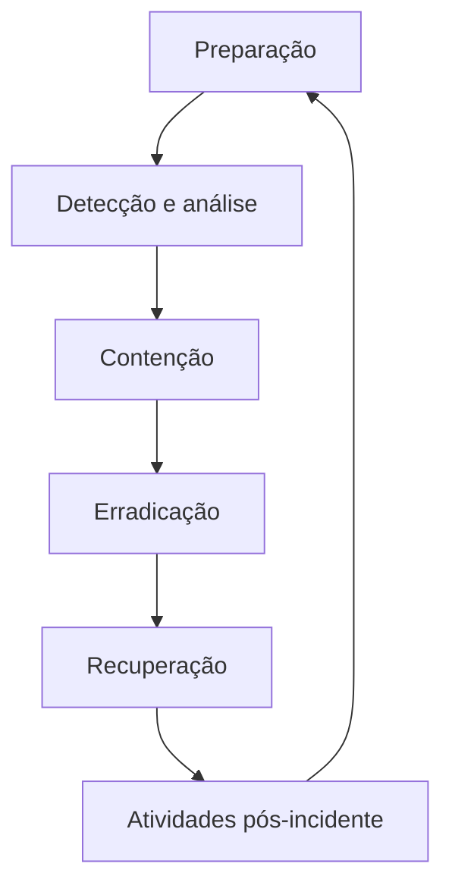

# Tratamento de incidentes de segurança

## Visão geral

O que uma equipe deve fazer ao descobrir um possível incidente de segurança? 

> Neste laboratório da **Cisco Networking Academy (NetAcad)**, o objetivo é formular perguntas para orientar a investigação e a resposta em cada etapa do processo.

A atividade apresenta dois cenários fictícios: a propagação de um worm em uma empresa e uma suspeita de acesso indevido a uma estação de trabalho com o sistema de folha de pagamento aberto em um hospital.

---

## Objetivos

- Entender as etapas do tratamento de incidentes.
- Identificar perguntas que ajudam a investigar cada cenário.
- Relacionar sinais observados às possíveis ações de resposta.
- Reconhecer a importância de preservar evidências e envolver as equipes responsáveis.
- Refletir sobre melhorias após um incidente.

---

## Etapas da resposta

| Etapa | O que acontece? |
|---|---|
| Preparação | A organização define responsabilidades, procedimentos e recursos para responder. |
| Detecção e análise | A equipe identifica sinais, investiga o que aconteceu e avalia a prioridade. |
| Contenção | Busca limitar a propagação ou o impacto do incidente. |
| Erradicação | Busca remover a causa identificada e os componentes maliciosos. |
| Recuperação | Restaura os serviços e acompanha o retorno ao funcionamento. |
| Atividades pós-incidente | Registra aprendizados e identifica melhorias na prevenção e na resposta. |

---

---

## Cenário 1: propagação de worm

Uma pequena empresa de investimentos, com menos de 100 funcionários e uma única unidade, enfrenta a disseminação de um **worm**. O programa malicioso se espalha por mídias removíveis e compartilhamentos abertos do Windows. Ao infectar um computador, instala um agente que pode participar de ataques DDoS.

As assinaturas de antivírus ficaram disponíveis algumas horas após o início da propagação. Nesse intervalo, houve infecções generalizadas. A empresa conta com uma pequena equipe de especialistas em segurança.

---

### Perguntas para orientar a resposta

| Etapa | Perguntas para a equipe |
|---|---|
| Preparação | Quais procedimentos e responsáveis devem ser acionados? Quais medidas já existem para limitar a propagação? |
| Detecção e análise | Quais computadores apresentam sinais de infecção? Que registros ou alertas ajudam a avaliar a extensão e a prioridade do incidente? |
| Contenção | Como limitar a propagação por mídias removíveis e compartilhamentos? Quais sistemas precisam ser isolados, considerando o impacto nas atividades? |
| Erradicação e recuperação | Como remover o worm e o agente DDoS? Como verificar os computadores e restaurar os serviços com segurança? |
| Atividades pós-incidente | O que pode melhorar a detecção e reduzir a chance de uma nova propagação? |

**Evidências a considerar:** alertas de segurança, registros dos equipamentos e informações sobre os compartilhamentos. A equipe deve definir como coletar, armazenar e preservar as evidências conforme os procedimentos da organização.

---

## Cenário 2: suspeita de acesso à folha de pagamento

Um hospital de médio porte possui várias unidades, mais de 5.000 funcionários e equipes de resposta distribuídas. Uma equipe de coordenação apoia a comunicação, e parte do monitoramento é realizada por um fornecedor de segurança 24 horas por dia.

Uma administradora da folha de pagamento viu uma pessoa desconhecida sair do escritório. Ela havia deixado o computador desbloqueado por alguns minutos e percebeu que o mouse parecia ter sido movido. O sistema continuava aberto. A equipe de resposta foi acionada para obter evidências e investigar quais ações, se houver, foram realizadas.

---

### Perguntas para orientar a resposta

| Etapa | Perguntas para a equipe |
|---|---|
| Preparação | Quais equipes devem ser acionadas? Quais procedimentos orientam o tratamento de uma suspeita de acesso indevido? |
| Detecção e análise | Há registros de acesso ou alterações no sistema durante o período? O que as informações disponíveis indicam sobre a atividade? |
| Contenção | Que medidas podem proteger a estação e a conta enquanto a investigação ocorre, preservando as evidências? |
| Erradicação e recuperação | Se houver acesso ou alteração indevida, quais ações serão necessárias para corrigir o problema e restaurar as informações? |
| Atividades pós-incidente | Como reforçar o bloqueio de tela e o controle de acesso físico? O que pode melhorar a comunicação entre as equipes? |

**Evidências a considerar:** registros de acesso e de alterações no sistema, informações da estação e registros de segurança física disponíveis. A movimentação aparente do mouse é um indício a investigar; por si só, não confirma que registros foram acessados ou alterados.

---

## Preservação e comunicação

Durante a análise, é importante registrar quem identificou o incidente, o horário, as ações realizadas e as pessoas envolvidas. A coleta e a guarda de evidências devem seguir os procedimentos da organização, para preservar sua integridade e permitir a investigação.

A comunicação entre segurança, suporte e demais responsáveis ajuda a coordenar a resposta. Informações sobre o incidente devem ser compartilhadas com quem precisa delas para atuar.

---

## Conhecimentos trabalhados

- Organizar a resposta em etapas ajuda a equipe a agir com mais clareza.
- Um sinal suspeito deve ser investigado antes de se concluir o que aconteceu.
- A contenção procura reduzir o impacto enquanto a equipe investiga e prepara a recuperação.
- Evidências e registros ajudam a compreender o incidente e apoiar decisões.
- A revisão posterior permite melhorar procedimentos, treinamento e detecção.
- O Suporte de TI pode contribuir ao registrar sinais, acionar a equipe responsável e seguir as orientações de tratamento.

---

## Entendendo os termos técnicos

| Termo | O que significa? |
|---|---|
| Incidente de segurança | Evento que compromete ou pode comprometer a proteção de sistemas ou informações. |
| Worm | Programa malicioso capaz de se espalhar entre dispositivos. |
| DDoS | Ataque que usa várias origens para tentar tornar um serviço indisponível. |
| Evidência | Informação que ajuda a entender o que aconteceu, como um registro ou alerta. |
| Contenção | Medidas para limitar a propagação ou o impacto de um incidente. |
| Erradicação | Remoção da causa identificada e dos componentes maliciosos. |
| Recuperação | Retorno dos sistemas e serviços ao funcionamento após o incidente. |
| Logs | Registros de atividades, como acessos ou alterações em sistemas. |

---

## Onde esse conhecimento pode ser aplicado?

**Cenário fictício: mensagem suspeita em uma empresa**

**Situação:** uma funcionária recebe uma mensagem suspeita e informa a equipe de suporte após perceber uma atividade incomum em sua conta.

**Aplicação:** o suporte registra o relato e aciona os responsáveis. A equipe de segurança investiga os sinais e, conforme o caso e os procedimentos internos, limita o acesso, protege as evidências e orienta a recuperação.

**Benefício esperado:** responder de forma organizada e usar os aprendizados para melhorar a prevenção. O exemplo relaciona as etapas estudadas a uma situação do cotidiano.
